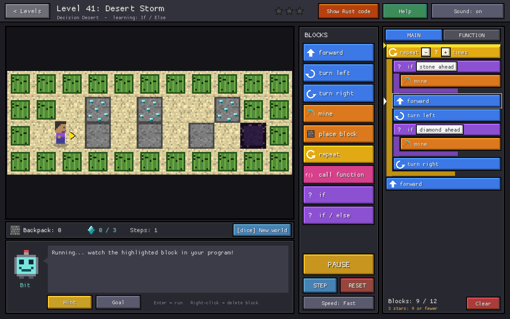
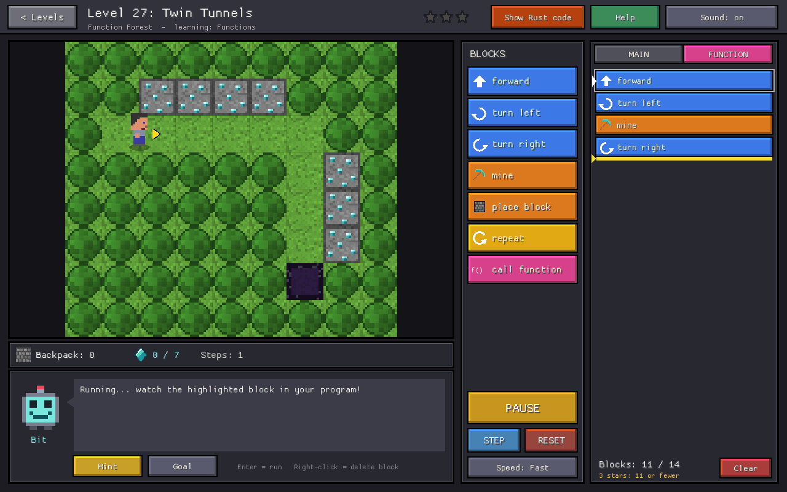
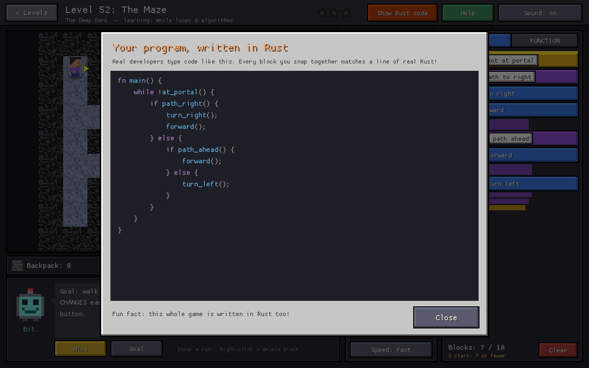
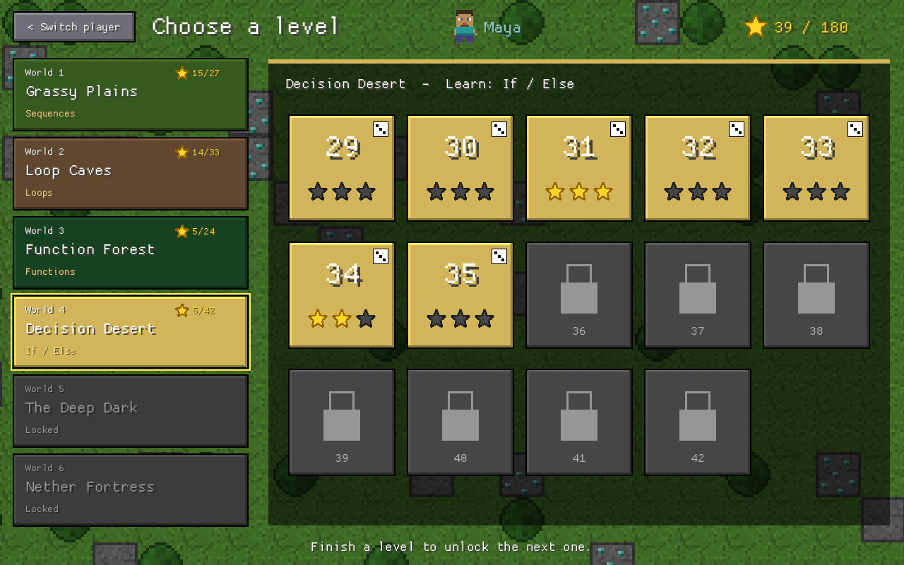
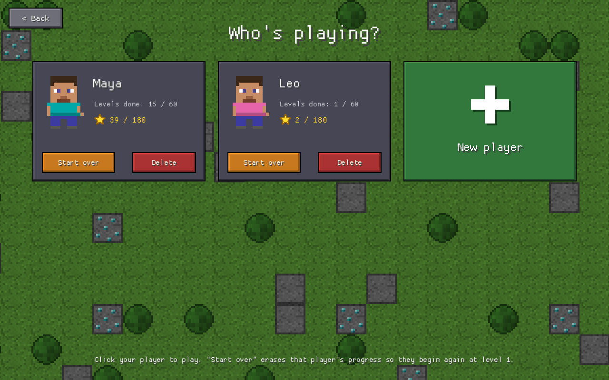

# Block Coders

**A blocky, Minecraft-style coding adventure that teaches kids (ages ~8–12) to
think like programmers.** It's written in Rust.

Kids snap together code blocks to guide a miner through 72 levels. They dig
tunnels, collect diamonds, bridge lava and find their way to the portal. Each
world introduces one big programming idea. As they go, the game shows them that
their blocks are real code.



## What kids learn

| World | Levels | Concept | What it looks like |
|---|---|---|---|
| 1. Grassy Plains | 1–10 | **Sequences** | Step-by-step instructions, turning, mining, building bridges |
| 2. Loop Caves | 11–22 | **Loops** | `repeat`, spotting patterns, loops inside loops |
| 3. Function Forest | 23–31 | **Functions** | Write a set of steps once, then call it anywhere |
| 4. Decision Desert 🎲 | 32–46 | **If / Else** | Look at the world, then decide what to do |
| 5. The Deep Dark 🎲 | 47–59 | **While loops & algorithms** | Roads of unknown length, and solving mazes with the right-hand rule |
| 6. Counting Caverns 🎲 | 60–66 | **Variables** | A box called `count` that holds a number: set it, add to it, and repeat that many times |
| 7. Nether Fortress 🎲 | 67–72 | **Master challenges** | Everything combined |

Every world starts gently and gets harder. 🎲 marks the **dynamic levels** (37 of
the 72). Their layout changes every time you press RUN, so a memorized path
won't work. The program has to look at the world and decide what to do, just
like real software.

## Features

- **Bit, a friendly robot guide**, explains each new idea when it first appears.
- **A guided tour for first-timers.** The first time a player opens level 1,
  Bit walks them round the screen one thing at a time: what clicking (or
  tapping) is, the world, blocks, the program, RUN, STEP, Hint and Help.
  Everything except the spot Bit points at is dimmed and can't be clicked, so
  nobody gets lost. *Skip tour* ends it, and level 1's Help can show it again.
  Nothing about the tour is saved.
- **Smart hints.** *Hint* looks at the kid's actual program, not just the
  level. Bit tries every single change in the game's own simulator. If one
  change would solve the level (in every version of a changing level), each
  press of *Hint* says a little more: first a nudge, then a yellow outline on
  the block, then the exact change ("Change the REPEAT from 8 to 10"). A fix
  only counts if it wins the way the level means: every block does something,
  and the program doesn't just get lucky because the game stops at the portal.
  If no single change is enough, Bit explains what went wrong and which way
  the goal is. A program that already works gets help with blocks that never
  run, loops that go round too often, patterns a loop could shorten, and a
  block that ends both parts of an IF / ELSE (it happens either way, so it can
  go once, after it). It all runs on the device, with no network and no AI
  service.
- **Drag and drop, with undo.** Drag blocks from the palette or rearrange the
  program by dragging. Every change can be undone and redone.
- **Step-by-step debugging.** *STEP* runs one block at a time, and the running
  block lights up. When something goes wrong, the block that caused it gets a
  red outline, and Bit explains what happened in kid-friendly words ("Ouch,
  lava! Place a block on it first").
- **The game can't be gamed.** After a kid wins a dynamic level, the game
  quietly tests their program in 80 other versions of that level. If the program
  only works by luck, Bit explains what went wrong and can show the world where
  it failed.
- **"Show Rust code"** turns the kid's block program into real Rust code, with
  colors like a code editor. This is the bridge from blocks to typing code.
- **Boss fights.** Each world with a World Check ends with a boss fight in 3
  stages. Kids break the boss's glowing crystals using the world's idea, and
  each cleared stage knocks a third off its health bar. The miner has 5 hearts:
  a run where it gets hurt costs half a heart, and testing a program that just
  stops early is free.
- **World Checks.** At the end of each world, a 10-question check asks kids to
  read short programs and work out what they do. 8 right (75%) opens the next
  world, and retries are unlimited, with mostly new questions each time. Each
  check asks at most 2 of the hardest "which program works every time?"
  questions. The Nether Fortress opens once all six checks are passed. Kids
  who already know a world's idea can take its check straight away to skip
  ahead.
- **A variable you can watch.** In the Counting Caverns, the `count` variable
  is drawn as a box under the world. It lights up and shows its new number
  every time a block changes it, so kids can see a value change as the program
  runs.
- **Stars for short programs.** Three stars means you matched the shortest
  solution, which rewards using loops and functions well.
- **Up to 6 players.** Each player has their own name, a miner with their own
  shirt color, and their own saved progress. Any player can *start over* from
  level 1.
- **Readable on phones.** On a small screen every screen reshapes instead of
  shrinking. Upright, the play screen stacks the world, Bit, then the blocks
  and the program, with RUN along the bottom; the level select shows a list of
  worlds and then a world's levels; World Check questions show one program at
  a time; and the keyboard has phone-style rows. Sideways, screens keep their
  desktop arrangement, resized.
- **Works on touch screens.** On a computer with a touch screen, an on-screen
  keyboard pops up for typing player names. Anyone can open it with the
  keyboard button in the name box.
- **Easy-to-read text.** All text is in [Atkinson Hyperlegible](https://www.brailleinstitute.org/freefont/),
  a font the Braille Institute designed so letters never look alike (l, 1 and I;
  0 and O), with its Mono version for the Rust code view. It replaced a thin
  bitmap font; at the same size its lowercase letters are a third taller.
- **No image or sound files.** All the pixel art and sound effects are
  generated by code. The two fonts are the only files built in
  (`assets/fonts/`, SIL Open Font License).

<p>
  
  
  
  
</p>

## Install (Linux)

Build the installable package (you need a [Rust toolchain](https://rustup.rs)):

```sh
packaging/make-package.sh
```

This runs the tests, builds an optimized binary, and writes
`dist/block-coders-<version>-linux-x86_64.tar.gz` (under 1 MB). On the target
computer:

```sh
tar xzf block-coders-*-linux-x86_64.tar.gz
cd block-coders-*-linux-x86_64
./install.sh               # just for you; or: sudo ./install.sh --system
```

Block Coders then appears in the app menu. It runs on any 64-bit Linux with
glibc 2.34 or newer: Ubuntu 22.04+, Debian 12+, Fedora 35+, Mint 21+, and
Arch-based distros. `./uninstall.sh` removes it again.

## Build from source

You need a [Rust toolchain](https://rustup.rs). Then:

```sh
git clone https://github.com/rpforonda/block-coders.git
cd block-coders
cargo run --release
```

The only dependency is [macroquad](https://macroquad.rs). On Linux, the ALSA
development headers must be installed (`libasound2-dev` on Debian/Ubuntu,
`alsa-lib-devel` on Fedora; Arch already includes them). The window can be
resized and the game scales to fit.

## How to play

| Action | How |
|---|---|
| Add a block | Click it in **BLOCKS** (it goes in at the yellow cursor), or drag it to exactly where you want it |
| Move or reorder blocks | Drag a block in your program to a new spot. Blocks inside it come along. Hover a MAIN/FUNCTION tab while dragging to move it there. |
| Move the cursor | Click between blocks in your program |
| Delete a block | Drag it out of the program, click its **x**, or right-click it. **Backspace** deletes the block above the cursor. |
| Undo / redo | **Undo** and **Redo** buttons, or **Ctrl+Z** / **Ctrl+Y** |
| Change a number (repeat, set count, add to count) | Click **−** / **+** on the block |
| Change what an if/while checks | Click the white label on the block |
| Run / step / reset | **RUN** (or **Enter**), **STEP**, **RESET** |
| Try another version of a 🎲 level | Click **[dice] New world** |

### For parents

- **Ctrl+U** on the level screen unlocks every level.
- **Ctrl+Shift+S** inside a level loads a working solution, in case you need
  to help.
- Progress is saved in `~/.local/share/block-coders/`. To move a kid's
  progress to another computer, copy that folder.
- In the web version, progress is saved in that browser's local storage on that
  device only. Nothing is sent anywhere. Clearing the site's data in the browser
  (or deleting the player) erases it.

## Project layout

| Path | What's there |
|---|---|
| `src/levels.rs` | All 72 levels as small text maps, with hints and lessons |
| `src/world.rs` | The game rules: tiles, the miner, what each action does |
| `src/program.rs` | Code blocks, a tiny compiler, and the virtual machine that runs them |
| `src/editor.rs` | The block editor |
| `src/play.rs` | The gameplay screen: animation, run controls, popups |
| `src/tour.rs` | The guided tour on level 1 |
| `src/main.rs`, `src/users.rs` | Title, player select and level select screens |
| `src/save.rs` | Players and saved progress |
| `src/art.rs`, `src/sound.rs` | Pixel art and sound effects, generated by code |
| `src/tests.rs` | Checks that every level is solvable and fair |
| `packaging/` | Linux installer and the packaging script |
| `tools/audit_questions.py` | Optional TypeSafe check of the World Check explanations |
| `docs/` | [Design doc](docs/DESIGN.md) and [web version plan](docs/WEB.md) |

## Making your own levels

Levels are text maps, so it's easy (and a great project for older kids) to make
new ones. Copy a level in `src/levels.rs`, give it a **unique name** (progress
is saved by name), and edit the map:

| Symbol | Tile | Symbol | Random tile 🎲 |
|---|---|---|---|
| `.` | floor | `?` | stone **or** floor |
| `#` | stone (mine it) | `!` | lava **or** floor |
| `D` | diamond ore | `~` | water **or** floor |
| `E` | emerald | `*` | stone **or** lava |
| `W` / `L` | water / lava | `&` | stone, lava **or** floor |
| `T` / `B` | tree / bedrock wall | `$` | diamond ore **or** floor |
| `P` | portal | `p` | possible portal spot (one is picked) |
| `^ > v <` | start, facing that way | | |

A level can also list several `maps`. One is picked at random for each run.

Each world with a World Check ends with its boss fight (a level with a `boss`),
so put new levels before it. Boss stages also use `X` (a crystal to break) and
`K` (the boss's 2x2 body).

Then run:

```sh
cargo test
```

The tests check that every level's `solution` wins in 300 random versions of
the level. For dynamic levels, they also check that replaying the exact moves
from one version fails in another, which proves the level needs `if`/`while`.
The [design doc](docs/DESIGN.md#level-design-rules) lists the rules that keep
levels fair.

### Checking World Check explanations

`cargo test` proves every quiz answer is right, but not that Bit's explanation
makes sense. After editing `src/questions.rs`, you can have
[TypeSafe](https://docs.typesafe.ai) read the explanations. It flags any that
point at a choice by its position (choices are shuffled), disagree with the
right answer, are hard reading for 8–12, or don't say why:

```sh
cargo test export_questions -- --ignored
TYPESAFE_API_KEY=... python3 tools/audit_questions.py
```

It writes `target/question-audit/report.md`. Answers are cached, so a re-run
only asks about what changed. This needs a network connection and an API key,
so it isn't part of `cargo test`.

## Documentation

- [docs/DESIGN.md](docs/DESIGN.md): how the game works inside, and why it was
  built that way
- [docs/WEB.md](docs/WEB.md): plan for a browser version on GitHub Pages
