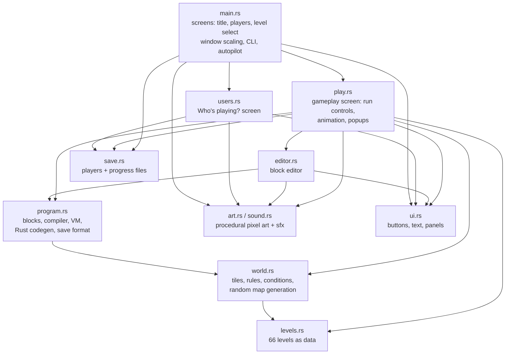

# Block Coders: Design

This doc explains how Block Coders works inside and why it's built the way it
is. It's for anyone changing the code or adding levels. For playing and
installing, see the [README](../README.md).

## Contents

1. [Goals](#goals)
2. [Teaching approach](#teaching-approach)
3. [Architecture](#architecture)
4. [The world model](#the-world-model)
5. [The program model](#the-program-model)
6. [Dynamic levels](#dynamic-levels)
7. [Curriculum and level design](#curriculum-and-level-design)
   - [World Checks](#world-checks)
8. [The block editor](#the-block-editor)
   - [Small screens](#small-screens)
   - [Scrolling](#scrolling)
   - [The guided tour](#the-guided-tour)
9. [Presentation](#presentation)
10. [Players and saving](#players-and-saving)
11. [Packaging](#packaging)
12. [Testing](#testing)
13. [Key decisions](#key-decisions)
14. [Limitations and future work](#limitations-and-future-work)

## Goals

**Goals**

- Teach the core ideas of programming (sequence, loops, functions,
  conditionals, while loops, algorithms) to kids aged about 8–12, through play.
- Make the ideas *necessary*, not just available. A level that teaches `if`
  shouldn't be solvable without `if`.
- Spark interest in real development: show that blocks are code and that the
  game itself is code (*Show Rust code*, editable text-map levels).
- Be easy to install and run: one small binary (the fonts are built in), no account,
  works offline.

**Non-goals**

- A free-form programming language. Kids get a small, fixed instruction set
  that's easy to discover.
- Typing code. The bridge to typed code is the read-only Rust view.
- Multiplayer, online features, or tracking.

## Teaching approach

The design follows a few principles:

| Principle | How the game applies it |
|---|---|
| **One new idea at a time** | Each world introduces one concept. New blocks appear in the palette only when their level arrives (`Level::palette`). |
| **Explain at the moment of need** | Bit's intro popup appears on the level that introduces something new, not in a tutorial up front. |
| **Make the concept necessary** | `max_blocks` limits force loops and functions. Dynamic levels force `if`/`while`. |
| **Mistakes are information** | Errors name the cause in kid language and outline the block responsible in red. Nothing is ever lost: RESET restores the world, and the program stays. |
| **Debugging is a skill** | STEP plus a highlighted running block make the program visible as it runs. |
| **Reward good code, not just working code** | Stars compare the block count with the level's shortest solution (`par`). |
| **Name the idea afterwards** | The victory popup's "What you learned" names the concept the kid just used (decomposition, nested loops, algorithm...). |
| **Connect to the real world** | *Show Rust code*, plus lessons that mention robots, mazes and apps. |

## Architecture

Single binary, ~5,400 lines of Rust, with one dependency:
[macroquad](https://macroquad.rs) for windowing, 2D drawing, input and audio.



The **logic layer** (`world`, `program`, `levels`, `save`) doesn't draw anything.
That lets the tests and the in-game "try other worlds" check run whole programs
instantly with `program::simulate`. The **presentation layer** (`play`, `editor`,
`users`, `main`, `ui`, `art`, `sound`) uses an immediate-mode style: every frame
it reads input, updates, and redraws from the current state.

### Screens and the frame loop

`main.rs` holds a `Screen` enum (`Title`, `Users`, `Select`, `Play`). Each
frame:

1. It computes a scale factor and sets a camera, so all drawing happens in a
   fixed **1280×800** virtual space, letterboxed to the real window size (see
   [Presentation](#presentation)).
2. It builds a `Ui` value with the mouse position in virtual coordinates and
   this frame's clicks.
3. It calls the current screen. The screen returns a navigation result (for
   example `Nav::Goto(level)`), and `main` switches screens.

`Ui::clicked` *uses up* a click, so overlapping widgets can't both react. Popups
set `ui.enabled = false` while the screen behind them is drawn, then turn input
back on for the popup itself.

## The world model

`world.rs` holds the game's rules. The `World` struct is a grid of `Tile`s plus
the miner's position, facing direction, backpack (block count) and the
gems collected/total.

| Tile | Walkable | Mine → | Place on it → |
|---|---|---|---|
| Floor | ✓ | *error: nothing to mine* | Cobblestone (a wall!) |
| Stone / Cobblestone | | Floor, +1 block | *error* |
| Diamond ore | | Floor, +1 diamond | *error* |
| Water / Lava | *error: splash / ouch* | *error* | Bridge |
| Bridge | ✓ | *error* | *error* |
| Emerald | ✓ (picks it up) | *error* | *error* |
| Tree / Bedrock | | *error* | *error* |
| Portal | ✓ | *error* | *error* |

Actions: `Forward`, `TurnLeft`, `TurnRight`, `Mine`, `Place`.
`World::apply(action)` returns `Ok`, `Won`, or `Fail(Failure)`. Each `Failure`
has a kid-friendly message.

Some rules are deliberately strict, because strictness is what makes
conditionals necessary:

- **Mining empty floor is an error.** Otherwise "mine, forward" in a loop
  would solve every random-stone level without an `if`.
- **Placing on floor builds a wall.** Otherwise "place, forward" would solve
  every random-lava level.

**Win condition:** the miner stands on the portal *and* has collected every
diamond and emerald. Until then the portal is drawn dark. The win is checked
after every action, so a program stops as soon as it wins.

**Sensors** (`World::check(Cond)`): `path ahead/left/right` (is the tile
walkable), `stone ahead`, `diamond ahead`, `lava ahead`, `water ahead`,
`not at portal`. Everything outside the map counts as bedrock.

## The program model

```
blocks (tree)  ──compile──▶  bytecode  ──Vm::next──▶  one action at a time
                                         ▲
                             world sensors (World::check)
```

### Blocks

A program is two lists of `Node`s: `main` and `func` (one user-defined
function). Each node has a `kind` (forward, turn left/right, mine, place, call,
repeat, if, if/else, while, set count, add to count, repeat count), and also a
`count` (the number on a repeat, set or add block), a `cond` for if/while, a
`body`, an `els` (else part), and a unique `id`. The id is how the running
block gets highlighted.

**The `count` variable.** There is exactly one variable, and its name is fixed,
so kids never type a name and nothing they make can name anything else. It
holds a whole number from 0 to `MAX_VALUE` (99). SET puts a number in it, ADD
adds to it (stopping at 99, so it can't overflow), and REPEAT COUNT TIMES reads
it. Every run starts it at 0. MAIN and the function share it, which the Rust
view shows by passing `&mut count` to the function.

### Compiler and VM

`Vm::new` flattens the tree into a small instruction set:

| Op | Meaning |
|---|---|
| `Act(action, id)` | Do an action (the VM pauses here and hands it to the game) |
| `Push(n)` / `Loop(top)` | Repeat: push a counter; at the end, count down and jump back |
| `PushCount(end, id)` | Repeat count times: push `count` as the counter, or skip the loop if it's 0 |
| `Set(n, id)` / `Add(n, id)` | Change `count`. The VM pauses here too (`Step::Var`) so the block lights up and the count box shows the new number |
| `JumpIfNot(cond, target, id)` | if / while test |
| `Jump(target)` | else-skip / loop back |
| `Call(id)` / `Ret` | Call the function / return |
| `Halt` | End of `main` |

`Vm::next(&world)` runs control instructions until it reaches the next
`Act`, then returns `Step::Act(action, block_id)`. The caller applies the
action, plays the animation, and asks for the next one. This **pause at every
action** design makes STEP, the highlight, animation pacing and instant
simulation all the same code path.

**Safety limits** (each gives a kid-readable error and outlines the block to
blame):

| Limit | Value | Catches |
|---|---|---|
| Actions per run | 600 | Walking in circles forever |
| Control steps without an action | 5,000 | `while` loops with nothing (or no movement) inside |
| Call depth | 100 | A function that calls itself forever |

### Rust code view

`Program::to_rust` prints the tree as Rust (`for _ in 0..3 { mine(); }`,
`while !at_portal() { ... }`, `fn my_function()`). The view colors keywords,
function calls and numbers.

### Save format

`Program::serialize` produces a compact token string, which is also the format
of each level's `solution` field:

```
[R4 F R F L ] F            repeat 4 { forward, right, forward, left } forward
[E3 M | P ]                if stone ahead { mine } else { place }
C C F / F L M R            main: call, call, forward   function: forward, left, mine, right
```

The tokens are `F L R M P C`, `S<n>` (set count to n) and `A<n>` (add n to
count), and `[R<n>`, `[I<c>`, `[E<c>`, `[W<c>`, `[V0` open a repeat, if,
if/else, while or repeat-count-times, where `<c>` is an index into `ALL_CONDS`. `|`
separates if/else branches, `]` closes a block, and `/` separates main from
the function.

## Dynamic levels

A level is **dynamic** (`Level::is_random`) if it has several `maps` or uses
random map symbols (`? ! * ~ & $ p`). `World::from_level(level, seed)` uses a
small xorshift RNG, so **a seed always produces the same world**. Seeds make
bugs reproducible and let the game show the exact world where something failed.

When a dynamic level is won, `play.rs` runs the program again with
`simulate` on 80 other seeds. If any of them fails, the win doesn't count. Bit
shows the failure message, and **"Show me that world"** loads that seed so the
kid can watch the bug happen. This is what makes the game "ungameable": a
program that wins by luck doesn't get the stars.

The **[dice] New world** button rerolls the seed. **RESET** keeps the same world,
so a kid can debug against a world that stays put.

## Curriculum and level design

Levels are data (`levels.rs`). They're grouped into seven chapters. Each chapter
starts with an intro level (enforced by a test) and ramps up:

```
Sequences (9) → Loops (11) → Functions (8) → If/Else (14) 🎲 → While & algorithms (12) 🎲 → Variables (6) 🎲 → Master (6) 🎲
```

Inside a chapter, difficulty grows by: more steps → mixing two concepts →
irregular layouts that defeat the previous chapter's tricks → several random
features at once. Examples:

- **Loops:** one loop → two loops → loops with two instructions inside →
  stairs patterns → nested loops (pond, snake tunnel, lawnmower).
- **If/Else:** one maybe-stone → two → a whole corridor → lava → stone *or*
  water (two `if`s) → stone *or* lava (`if/else`) → forks (path sensing) →
  diamonds on both sides → `if` inside functions.
- **Variables:** put a number in the box and repeat that many times → use it
  twice → ADD makes stairs that grow 1, 2, 3, 4 → a growing spiral of emeralds
  → count steps with WHILE and use the number later (Echo Hall) → count stones
  while mining. Each level is built so the variable is needed: the fixed ones
  leave out the numbered REPEAT and set a block limit, and in the changing ones
  the portal is somewhere no sensor can find, so only counting (or a sweep too
  long for the block limit) gets there. Tests check both.
- **While:** random-length wall → random-length tunnels and lava → roads that
  only turn right → spirals → roads that turn both ways → mazes → mazes with
  hazards.

### World Checks

At the end of each world (except the last), a **World Check** asks 10
read-the-code questions about that world's idea. 8 right (75%) passes and opens
the next world. Retries are unlimited.

- **Questions are read-the-code, not recall.** Each one shows a short block
  program, often with a small map, and asks what happens: where the miner ends
  up, how many times something runs, which program reaches the portal, or which
  program does the same thing. Questions live in `questions.rs`, 15 to 17 per
  world. Later worlds also include questions on earlier ideas (loops, functions),
  so those keep getting practice.
- **Every answer is proven.** Each question names how to check it (`Proof`),
  and `every_answer_is_right` runs the programs in the real VM. It fails if the
  marked answer is wrong, or if a wrong choice is also right. Questions on maps
  with random squares are checked in 300 versions of the map.
- **Retries get new questions.** An attempt takes every question that wasn't in
  the previous attempt first, then fills up from the rest, so each retry has
  at least 3 new questions (tests check this for every bank). The last attempt's ids are saved, so this
  holds across restarts too. Choices are shuffled every time, so Bit's
  explanations never point at a choice by position ("the middle program"):
  they name it by what it does ("the program that checks for lava").
- **At most 2 "works every time" questions per attempt.** Questions on a map
  that changes between versions make kids picture every version at once. They
  are the hardest kind to follow, so `pick` caps them at `MAX_CHANGING`.
- **Unlocking:** world *w* opens when Check *w*−1 is passed. Saves from before
  World Checks keep every world they had already reached, and can still take
  the checks they skipped. The last world (Nether Fortress) needs **all** checks
  passed, even for those older saves. One exception: the Counting Caverns world
  (and its check) came later, so a player who had already reached the Nether
  Fortress and passed the five checks there were then keeps it. A check opens
  once the world's last level is beaten. Parent mode (Ctrl+U) opens everything.
- `check.rs` has the screen, plus read-only drawing of programs and maps. Map
  squares that change between versions show their symbol with a legend
  ("? = stone or empty").

### Level design rules

These come from bugs found while building the levels.

1. **`par` equals the block count of `solution`**, and `solution` must stay
   within `max_blocks` and only use palette blocks and selectable conditions
   (all enforced by tests).
2. **`max_blocks` forces the concept.** Set it below the straight-line
   solution so that a loop or function is required. The functions levels use
   irregular spacing so that a plain loop can't beat a function.
3. **`start_blocks` covers the worst case.** If every random `!`/`*`/`&` turned
   out to be lava, the backpack must still have enough blocks.
4. **Never put a random tile right after a corner** on roads where the
   solution uses `path to left/right`. A stone or lava there makes the
   side-path check see a wall, and the miner turns the wrong way.
5. **In mazes solved with the right-hand rule, put obstacles only in straight
   corridors.** A wall-follower walks straight into obstacles there and deals
   with them. An obstacle next to a corner gets passed sideways, and the miner
   can circle forever ("Rubble Maze" originally failed this way).
6. **Win-on-arrival allows overshooting.** Because the game stops the moment
   the miner reaches the portal, `repeat 20 { forward }` wins any straight
   hallway that ends at the portal. To force `while`, put a *turn* after the
   variable-length part (as "How Far?" does).
7. **Bit talks in blocks.** Intros, hints and lessons use block names
   (`IF path ahead, FORWARD. ELSE, TURN RIGHT.`), never typed-code symbols
   like `{ }`. Kids only see code in "Show Rust code". Explain any programming
   word (bug, algorithm, decomposition) in plain words the first time it
   appears. A test rejects `{`, `}` and `;` in level text.
8. **Level names are save keys.** Keep them unique and never rename one that
   kids may already have finished. If you must rename, update
   `LEGACY_ORDER`.

The maze layouts were generated by a search (the ignored test `find_mazes`).
It looks for mazes that the right-hand rule solves but the simpler
road-following programs don't, which guarantees the maze levels teach something
new.

## The block editor

Kids can work either way: **click-to-insert** (click a palette block and it
goes in at the yellow cursor) or **drag and drop** (drag from the palette, or
drag blocks inside the program to reorder them).

- **Slots.** Each frame, `layout()` walks the tree and makes a list of rows
  (block, `else`, end cap) and **slots**: the gaps where a block could go.
  Every slot has a unique y position, so both clicks and drops simply pick the
  nearest slot. Empty bodies get their own visible gap.
- **Press, then decide.** Pressing on a palette block or a program block
  starts a `Drag` that isn't active yet. If the mouse moves more than 6 pixels,
  it becomes a real drag. If the button is let go first, it counts as a click
  (insert at the cursor, or move the cursor). So clicking keeps working exactly
  as before, and younger kids never *have* to drag.
- **While dragging:** a ghost block follows the mouse, a green line marks the
  drop slot, the original block is dimmed, and the list scrolls when you drag
  near its top or bottom edge. Slots inside the dragged block are skipped, so a
  container can't be dropped into itself. Hovering a MAIN/FUNCTION tab switches
  to it, so blocks can move between them. Dropping a program block outside the
  program panel deletes it (the ghost turns red and says "let go to delete").
- **Moving safely.** `Editor::move_node` first inserts a placeholder node at the
  target slot, then removes the dragged block from wherever it was, then
  replaces the placeholder with it. Removing a block shifts the positions after
  it, which would make a target path computed beforehand point at the wrong
  spot. The placeholder doesn't care. Unit tests in `editor.rs` cover moving
  down in the same list, into and out of containers and else parts, between
  tabs, and moving a container with its children.
- Inline controls (the `x`, `−`/`+`, the condition label) are handled before a
  press can start a drag, and their edits are collected as an `Edit` value and
  applied after drawing, so the tree is never changed while it's being read.

### Small screens

The game draws on a virtual canvas. On a screen where the desktop's 1280x800
fits at 80% or more, nothing changes: it's scaled to fit as before. Below that,
shrinking it would make text 6-9pt on a phone, so every screen gets a canvas
the shape of the screen at 80% instead (`layout::canvas`), and `layout.rs`
places everything for it: `Layout` for the play screen, and `title`, `users`,
`select_wide` / `select_tall`, `check` and `keyboard` for the rest. They're
pure functions of the canvas size, so tests check them on 12 screen sizes
without drawing anything. At 1280x800 each one returns the desktop's own
rectangles (a test checks them).

**The menus and World Check on phones.**

- **Title:** the same layout, squeezed on short screens; on the narrowest,
  the miner and Bit shrink and sit at the edges.
- **Players:** the fewest columns where every card fits *without scrolling*
  (one column upright, two or three sideways). Cards shrink, never below
  96px, and small cards switch to a one-row design: picture, name and stars,
  then "Start over" and "Delete" stacked on the right. The tip at the bottom
  goes first when space runs out.
- **Level select, upright:** two pages. A list of the 7 worlds, and one
  world's levels in a 3-column grid; the screen opens on the current world's
  levels, with "< Worlds" to switch. Sideways keeps the desktop's two columns,
  with a slimmer worlds column under 1100 wide, one-line world buttons when
  they're short, and as many level columns (3-8) as give the biggest tiles.
- **World Check, upright:** everything stacked, with Bit's explanation in its
  own space at the bottom. "Which program…?" questions show **one program at
  a time**: "<" and ">" to compare, then "This one! (Program A)". After
  answering, it flips to the right program ("This one works!"). Sideways puts
  the program and map on the left with Bit's explanation under them, and the
  answers (the program picker too) on the right.
- **Keyboard:** upright phones get phone-style rows ten keys wide (keys 43px,
  52px tall); wider screens keep the desktop rows, narrower or shorter if
  needed. The New player popup sits above it, and on short screens leaves out
  picking a miner until the keyboard is hidden.
- `BC_QUESTION=w6-09` (debug builds, with `BC_CHECK`) opens a World Check on
  that question, so the screenshot autopilot can show any kind of question.

- **Wide** (anything wider than tall: desktops, tablets, phones held
  sideways): the desktop's three columns, resized. Under 1100 wide the blocks
  and program columns are a little slimmer. At 1280x800 it's exactly the old
  layout (a test checks every rectangle).
- **Tall** (phones held upright): the world on top, then the info bar and Bit,
  then blocks and program side by side, with RUN / STEP / RESET / Speed along
  the bottom. While a program runs, the blocks step aside and the program fills
  the width under the world, so kids can watch the running block and the
  miner together. The moment it stops (it finished, crashed, or won and the
  popup is up), the blocks come back, so "Add more blocks" can be followed
  straight away. They used to wait for RESET, which nothing on screen pointed
  to. TypeSafe chose this over RESET-only and a "Blocks" button: finding the
  way back 1.87 of 2, against 0.27 and 0.75, and seeing the bug while fixing
  it 1.72, against 1.18 and 0.38 (`target/pedagogy-eval/blocks-back/`). Hint
  and Goal stack under Bit, so the message gets the full height.
- **The canvas is never shorter than 520 or narrower than 440.** Phones held
  sideways (about 375-430 points tall) are shrunk to fit that, so their text is
  about 14pt rather than 15. Screens under 360 points wide (older than today's
  phones) are best effort: everything fits, but panels are cramped.
- Text that might not fit steps down a little, never below 16px: titles,
  palette labels, Bit's long messages, and the Rust view (down to 11px, so the
  widest line fits), and RUN AGAIN (down to 20px). The info bar shortens its
  labels when narrow, and popups shrink to the canvas and stack their buttons
  when narrow. Where any speed's label is too wide for the Speed button, every
  speed goes on a second line under "Speed:", so the label keeps its shape as
  it's tapped.
- The guided tour's bubble goes beside its spot when there's room, else above
  or below it. In a browser, `web/storage.js` reports whether the screen is a
  touch screen (`matchMedia('(pointer: coarse)')`), so the tour says "tap"
  from the first step. The plugin's version is now 2.
- `BC_WINDOW=390x844` (debug builds) opens a phone-sized window, for the
  screenshot autopilot and for trying layouts on the desktop.

**How the menu layouts were chosen.** For upright phones, TypeSafe compared
options with real sizes (`target/pedagogy-eval/menus/`, not committed). The
two-page level select won (0.70; understanding 1.42/2, against 1.12 for world
buttons above the grid and 0.24 for one long scrolling list). One program at a
time won for program questions (0.82; readable 0.85, against 0.38 for all three
stacked and 0.08 side by side). For players, one column won the vote, but
two columns scored better on understanding (1.30 against 1.04, because one
column had to scroll on short phones); a third option, one column whose cards
shrink so nothing scrolls, won both (0.55; understanding 1.38). As built, the
three score 1.38, 1.35 and 1.31 for understanding. TypeSafe also chose the
program picker's words, for clarity and kindness to a child who got it wrong:
"This one! (Program A)", "A - tap the arrows to see all 3", "This one works!"
and "Your pick - nice try!" (instead of "You picked this one.").

**How the play screen layout was chosen.** TypeSafe compared arrangements for each screen
shape: stacked, tabs, world-and-program with a blocks drawer, and two hybrids.
It judged them for an 8-12 year old new to computers, given real sizes at a
readable scale (`target/pedagogy-eval/mobile/`, not committed). Tabs won its
"easiest overall" vote on upright phones (0.64), but scored 0.34 of 2 on
watching the miner and the running block together, which is how STEP
debugging is taught. Stacked-with-run-mode won the vote once the hybrids were
added (0.66), with 1.96 of 2 on watching both and 1.22 on findability.
Tabs-that-split-while-running was close (1.88 and 1.37). We took
stacked-with-run-mode: nothing is ever hidden behind a tab, and the blocks stay
left of the program as on desktop, so lessons and the tour still read right.
Columns won for sideways phones and tablets. Re-scored as built (with real
sizes), upright phones get 1.78 for watching both and 1.31 for findability;
sideways phones 1.44 and 1.03 (only 4 blocks show at once). No single part was
judged too small (all at or under 0.53). TypeSafe also picked the short label
"Show code" for upright phones.

### Scrolling

The blocks palette and the program (MAIN and FUNCTION) both scroll when they
don't fit, with the mouse wheel or a scrollbar (`ui::Scrollbar`). The
scrollbar can be dragged, or clicked above or below the thumb to move a page,
so it works without a wheel too: touch screens, some trackpads. It's 14 pixels
wide so a finger can grab it, and it only appears when there's something to
scroll. Rows are never drawn half-hidden. The palette scrolls a whole block at
a time, and the program skips rows that are partly out of view. RUN, STEP,
RESET and the speed button have their own panel under the palette, so no block
can end up behind them. A test checks the two panels never overlap and that
the biggest palette really needs (and gets) scrolling.

### Undo and redo

`Play` keeps two stacks of whole-program snapshots (programs are tiny, so
copies are cheap). At the start of every frame it remembers the program. At
the end, if the program changed (checked by comparing the save-format string),
the old version goes onto the undo stack and the redo stack is cleared. This
catches every kind of edit in one place, with no per-action bookkeeping: adds,
drags, deletes, count and condition changes, Clear, and the parent "load
solution" shortcut. Undo and Redo swap versions between the stacks and set a
flag so the swap itself isn't recorded. History holds 100 steps and lasts while
the level is open.

### The guided tour

The first time a player opens level 1 (an empty program), `tour.rs` runs a
9-step tour instead of the intro popup. It covers what clicking or tapping is,
the world, blocks, the program, STEP/RESET, Hint/Goal, Help and RUN.

- **One spot at a time.** Each step names a `Spot`, and `play.rs` maps it to a
  screen rectangle using the same constants that draw the buttons, so the
  highlight can't drift from the real button. Everything else is dimmed.
- **Clicks are gated, not faked.** At the start of the frame, a click outside
  the spot is taken away from the screen and handed back only to the tour's
  own NEXT and *Skip tour* buttons. Right-clicks and keyboard shortcuts are off
  during the tour (Escape skips it). The pointing hand is drawn, not real input.
- **Steps finish on real actions** (`Wait`): pressing NEXT, the program having
  1 or 4 blocks, or RUN starting. The tour ends when RUN starts, before the
  victory popup.
- **Touch screens** get "tap" instead of "click", and their own first step.
- **Nothing is saved.** The tour shows whenever level 1 opens with an empty
  program, and level 1's Help popup has *Show me around*. No new save data.
- Tests check that the tour can be finished, that it matches level 1, that no
  bubble covers its spot, and the touch wording. `BC_TOUR=1` keeps the tour up
  in the screenshot autopilot so `BC_INPUT` can click through it.

**Following the running block:** while a program runs, the editor switches to
the tab (MAIN or FUNCTION) that holds the highlighted block. It does this
**only when the highlighted block changes**. An earlier version switched every
frame, which locked kids out of the MAIN tab after an error inside the function.

## Presentation

- **Fixed virtual canvas.** Everything is laid out in 1280×800 and scaled with a
  `Camera2D` plus a letterbox viewport. Any window size, tiling window managers
  and odd aspect ratios all work. Mouse positions are converted back into
  virtual coordinates.
- **Readable colours (WCAG AA, 4.5:1).** Buttons and blocks don't pick their
  text colour by eye. `ui::readable_bg` darkens a colour just enough for white
  text (never below 78% brightness). Colours that would need more, the bright
  yellows like Hint, World Check, and REPEAT / WHILE, keep their colour and get
  near-black text instead (`ui::text_on`); block icons follow the label. Hover
  states move away from the text colour, so hovering never lowers contrast.
  Titles on the light popups use `TITLE_ON_LIGHT` / `WARN_ON_LIGHT` instead of
  yellow, and locked items use `LOCKED_TEXT`. Tests check every colour on a
  grid, every block, every world's tiles and the popup titles. (Before this, the
  Hint button was white on gold at 2.5:1, and REPEAT blocks at 2.1:1.)
- **Sharp text when scaled.** `ui::text` renders fonts at the real on-screen
  pixel size (`font_size × scale`, `font_scale = 1/scale`), so text stays
  sharp at any window size. macroquad multiplies by the screen's pixel density
  itself, so `scale` leaves density out.
- **Font atlas growth.** macroquad 0.4.16 deletes its glyph texture as soon as
  a new glyph makes it grow, while text queued earlier in the frame still uses
  it, and miniquad 0.4.11 then re-binds the deleted texture from its cache. So
  `ui::cache_glyphs` flushes queued drawing and clears miniquad's bindings
  before any text with an uncached glyph, then caches the whole string before
  drawing it. Remove this if macroquad fixes it upstream.
- **Procedural art** (`art.rs`). Every texture is a 16×16 image built by a
  function of (x, y): hashed noise for grass and stone, sine patterns for
  animated water, lava and portal frames, and ASCII pixel-art for the miner,
  Bit, the pickaxe and the app icon. The miner is generated in eight shirt
  colors, one per player choice.
- **Procedural sound** (`sound.rs`). Square, triangle and noise waves with a
  short fade-in/out are written into in-memory WAV files at startup.
- **Animation.** Each action makes an `Anim` (move, turn, mine, place, bump,
  hazard). Effects such as crack overlays, particles and "+1 diamond" text fire
  partway through. The run speed setting (Slow/Normal/Fast/Turbo) sets the
  animation length, which is also the time between steps.

## Players and saving

Files live in `$XDG_DATA_HOME/block-coders/` (usually
`~/.local/share/block-coders/`):

```
users.txt        id;shirt;name           one line per player
                 next;<id>               the next id to hand out (ids are never reused)
user-<id>.txt    gen;<n>                 how many times this player started over
                 level name;stars;program  one line per level
                 check:<n>;<passed 0/1>;<last question ids>  one line per World Check
```

- **Saved by level name, not number**, so levels can be inserted or reordered
  freely. Older saves that numbered levels 0–19 are converted on load using
  `LEGACY_ORDER`. An even older single-player `progress.txt` becomes "Player 1".
- **Unlocking:** level *i* is open if it's level 1, or if *i* ≤ (furthest level
  with stars) + 1, and its world is open (see [World Checks](#world-checks)).
  So beating a level opens everything before it, and new levels added early in
  the list never lock out a player who already went further.
- **Writes happen on every program edit and every win.** The files are tiny, and
  this means closing the window never loses work.
- Players have up to 12 characters (letters, digits, space, `-`, `_`), and there
  can be at most 6 players. "Start over" rewrites the player's file empty (and
  bumps `gen`), and "Delete" removes it. Both ask for confirmation.
- **Several tabs or windows at once.** Browser tabs share one localStorage, and
  two desktop windows share one folder, but each loaded the player list when it
  started. So the list is re-read whenever "Who's playing?" opens, and again
  right before adding or deleting a player. Otherwise a tab opened earlier would
  write back its old list, dropping players added elsewhere, and hand their id
  (and wipe their stars) to the new player. Ids come from `next`, so a deleted
  player's id is never handed out again, and they also skip any id that still
  has a save file. If another tab took the name or the last free spot in the
  meantime, "Let's play!" is refused and the popup shows why.
- **Two tabs playing the same player.** Saving a player re-reads their file
  and merges: stars and passed checks only go up, and a program or set of
  check questions this tab didn't change keeps the stored version. If the
  stored `gen` differs, the player started over elsewhere, so nothing is
  written and this tab takes the stored progress instead (`Saved::StartedOverElsewhere`);
  an open level swaps in the stored program too, or its next edit would save
  the old one again. The merge baseline only moves on when a write works, so a
  failed save (storage full) doesn't make the next one drop this tab's edits. A player missing
  from `users.txt` was deleted elsewhere and is never written back. The
  read-merge-write isn't atomic, but it runs in one go on each save, so two
  tabs would have to save in the same instant to collide.

## Packaging

`packaging/make-package.sh` runs the tests, builds the release binary (with
symbols stripped), checks portability, writes the icon (`block-coders
--write-icon`), and creates a tarball with `install.sh`/`uninstall.sh` and a
`.desktop` entry.

- **Portability limit is glibc 2.34.** The script reads the binary's required
  glibc symbol versions (`objdump -T`) and fails the build if anything needs
  more. Lesson learned: on a very new distro, a single `f32::atan2` call pulled
  in `atan2f@GLIBC_2.43`, which made the binary unusable on Ubuntu and Debian.
  It now uses f64 `atan2`.
- macroquad loads OpenGL/X11/Wayland at runtime (`dlopen`). The only hard link
  dependency is `libasound.so.2`. `install.sh` warns if it's missing.
- The window class is set to `block-coders`, matching `StartupWMClass` in the
  `.desktop` file, so desktops show the right icon.
- A user install needs no root (`~/.local/bin` and `~/.local/share`).
  `--system` installs to `/usr/local`.

## Testing

`cargo test` (well under a second):

| Test | Guarantees |
|---|---|
| `every_solution_wins_in_every_world` | Every level's `solution` wins in 300 random worlds, and `par` matches its block count |
| `dynamic_levels_cannot_be_hardcoded` | For each dynamic level, replaying the exact moves that won one world fails in some other world |
| `shortcuts_fail_somewhere` | Specific tempting shortcuts fail (e.g. "mine everything", road-following on a maze) |
| `solutions_only_use_available_conditions` | Solutions only use conditions the kid can pick in that level |
| `level_list_is_sane` | 66 levels, unique names (save keys), chapters in order, intro on each chapter's first level, hint and lesson present |
| `maps_are_well_formed` | Rectangular maps, exactly one start, fits the screen |
| `serialize_round_trips` | The save format round-trips |
| `editor::tests::*` | Moving blocks: reordering, into/out of containers and else parts, between tabs, with children, and unique ids afterwards |
| `players_can_be_created_reset_and_deleted` | Player files, legacy migration, unlock rules |
| `read_only_saves_never_change` | While the autopilot's read-only switch is on, adding, deleting or resetting players changes nothing on disk |
| `a_stale_tab_keeps_other_tabs_players` | A tab that loaded the player list earlier never drops or overwrites players another tab added, and respects names and the 6-player limit they took |
| `a_stale_tab_never_overwrites_newer_progress` | A tab playing the same player as another never erases its stars or checks, undoes its "Start over", or writes a deleted player back or into a new player |
| `empty_while_is_caught` | The VM's infinite-loop guard |
| `world_checks::every_answer_is_right` | Every World Check answer is right, and every wrong choice is wrong, by running the programs |
| `world_checks::explanations_never_point_at_a_position` | No explanation says "the middle program", "Program B" and so on, since choices are shuffled |
| `world_checks::banks_are_big_enough_and_well_formed` | 13+ questions per bank, unique ids, programs parse, spots on the map |
| `world_checks::retries_get_new_questions` | 10 different questions per attempt, at least 3 new on every retry |
| `world_checks::choices_are_shown_in_a_random_order` | The right answer is shown in each place about equally often, and every order of the choices comes up |
| `world_checks::checks_gate_the_next_world` | Check unlock rules, old saves, the last world needing every check |
| `world_checks::check_results_are_saved` | Check results round-trip, and hand-edited entries are cleaned |

**Screenshot autopilot** (development only: debug builds read these settings,
release builds ignore them). Setting `BC_SHOT=<dir>` makes the game drive itself: the title, the player screens, a level (`BC_LEVEL=<index>`)
loaded with its solution (or with `BC_PROGRAM=<program string>`), the Rust view,
a run, and the result. It saves a PNG at each step. `BC_CLICK=x,y` injects a
click after the run, which was used to reproduce and verify the tab-switching
bug. `BC_INPUT="x,y,act;..."` plays one scripted mouse step per frame (`move`,
`down`, `up`, `shot`, `dump`), which tests drag-and-drop and undo with real
input handling. `dump` prints the program after each step. `BC_CHECK=<n>`
opens World Check n (0-based) instead of a level, and stops after its intro
unless `BC_INPUT` drives it.

Safety rails, so the autopilot can't run or do damage by accident:

- Only debug builds read any `BC_*` setting except `BC_TOUCH`, which just forces the
  touch keyboard (`dev_env` in `main.rs`; `BC_PROGRAM` goes through it too).
  Release builds and the web build ignore them all. The browser has no
  environment variables anyway.
- When `BC_SHOT` is set, the game prints a warning to stderr first. A variable
  left in the shell (e.g. a fish `set -U`) would otherwise quietly turn every
  `cargo run` into the autopilot.
- Saves are read-only for the whole run (`save::set_read_only`). The autopilot
  shows the real players and opens a "Start over" popup for the first one, and
  real mouse and keyboard input still work, so without this a stray click or
  Enter could create or wipe a player.
- The screenshot folder is created if it's missing.

Still set `XDG_DATA_HOME` to a temporary folder for test runs, so the
screenshots don't show real players' names.

## Key decisions

| Decision | Alternatives | Why |
|---|---|---|
| macroquad | Bevy, ggez, egui | Small, fast to compile, simple immediate-mode 2D, built-in audio, and it builds for the web. Bevy's ECS is overkill for a grid game. |
| Click-to-insert *and* drag-and-drop | Only one of them | Clicking is easier for young kids and trackpads. Dragging is faster and is what Scratch users expect. Both use the same slot system. |
| Undo by whole-program snapshots | An undo entry per edit type | One generic check at the end of the frame can't miss a kind of edit, and programs are tiny. |
| Fixed 1280×800 virtual canvas, reshaped only on small screens | Fully responsive layout | One desktop layout to design and test. Below 80% scale the play screen switches to a screen-shaped canvas with two tested layouts (wide and tall), so phones get readable text. |
| Procedural assets | Image/sound files | A single self-contained binary, nothing to lose or load, and the art is itself code kids can explore. |
| Atkinson Hyperlegible (built in) | macroquad's built-in bitmap font, Andika, Lexend, a pixel font | Legibility for young and weak readers comes first. TypeSafe scored it 1.95/2 for 8-year-olds reading hints and labels (the old font 0.28) and best at telling l/1/I and 0/O apart in code (0.71, the old font 0.13). A pixel font matched the art better (0.88) but read worse (1.09). Its Mono is used for the Rust view, which lines letters up. |
| Bytecode VM that pauses at actions | Walking the tree with recursion | Stepping, highlighting, animation and instant simulation all share one path. Infinite loops are easy to detect. |
| One function (no parameters) | Several named functions | Enough to teach reuse at this age. More would need naming UI. |
| One variable with a fixed name, whole numbers 0–99 | Named variables, text, negative numbers | One box is enough to teach "store, change, use". No typing means no naming UI and nothing a child types ever becomes code. The bounds mean no overflow, and REPEAT COUNT stays small. |
| Strict rules (mining air fails, placing on floor walls you in) | Forgiving rules | Without them, random levels could be solved without conditionals. |
| Win-on-arrival | Win only when the program ends | Feels better ("I made it!") and avoids "why didn't it win?" confusion. Levels work around the overshoot loophole (rule 6). |
| Verify wins on 80 other seeds | Trust a single run | Without it, kids could pass a dynamic level by luck and learn the wrong lesson. |
| Plain-text save files | JSON/serde | Zero dependencies, human-readable, easy for a parent to back up or inspect. |
| Bit spots a block that ends both parts of an IF / ELSE, before "Check your REPEAT numbers" | No such hint; after the REPEAT hint; last | A player's 12-block "Both Sides" (3 stars at 11) turned back the same way in both parts of each IF / ELSE. Bit only said "Check your REPEAT numbers", and following that made 13 blocks. TypeSafe chose adding the hint (0.97; helps 0.83, could mislead 0.27), putting it first (0.86), and wording with the TOP and BOTTOM parts the IF / ELSE intro teaches (0.57, against 0.32 and 0.11). An extra tip that an empty BOTTOM part works like a plain IF scored 0.47 and was left out. |

## Limitations and future work

- **Linux only so far.** macroquad supports Windows and macOS, but no packages
  exist yet. A GitHub Actions matrix could build them.
- **Web version.** Planned; see [WEB.md](WEB.md). The main change is moving
  saves to browser storage.
- **Touch screens.** Taps work as clicks, and every screen reshapes for
  phones (see [Small screens](#small-screens)). There's no drag-to-scroll:
  the layouts avoid scrolling where they can, and long lists (the blocks, a
  long program, the Rust code) have scrollbars.
- **Accessibility.** No screen reader support. Colors are bold and paired with
  icons and text labels, but they haven't been checked for color blindness.
- **One function, no parameters, one variable.** Possible next concepts:
  counters ("repeat until you have 3 blocks"), parameters ("dig(n)"), or a
  second function.
- **Level authoring needs Rust.** Levels are compiled in. Loading levels from
  text files would let kids make and share levels without rebuilding.
